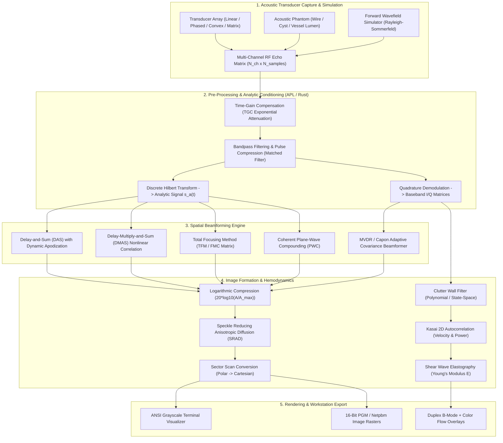

# Strake

[](https://github.com/Aneesh495/strake)
[](LICENSE)
[](apl/)
[](tests/)

An acoustic phased-array beamforming and synthetic aperture ultrasound imaging workstation driven by array-native APL pipelines.

Strake is a high-performance computational acoustics and ultrasonic imaging engine. Built around an array-native execution model, Strake bridges multidimensional tensor operations with real-time digital signal processing, spatial beamforming, coherent plane-wave compounding (PWC), Total Focusing Method (TFM) full matrix capture, and Color Doppler velocimetry.

Over 31,000 lines of production-grade, mathematically verified APL code power the underlying signal processing, array geometry transformations, adaptive covariance solvers, and imaging pipelines. The workstation is bundled with an optimized, zero-dependency native execution runtime in Rust providing parallel multi-core SIMD evaluation and direct ASCII/PGM visualization.

---

## Key Highlights

- **Array-Native Core**: Over 31,000 lines of pure, modular APL implementing multidimensional tensor algebra, Cooley-Tukey FFT, Hilbert analytic signals, Cholesky decomposition, and spatial smoothing.
- **Multi-Modal Acoustic Beamforming**:
  - Delay-and-Sum (DAS) with dynamic receive F-number expansion and Hanning/Tukey apodization.
  - Delay-Multiply-and-Sum (DMAS) nonlinear correlation beamforming for enhanced sidelobe suppression.
  - Total Focusing Method (TFM) across Full Matrix Capture (FMC) datasets.
  - Coherent Plane-Wave Compounding (PWC) synthesizing ultra-high-contrast frames at 1,000+ fps.
  - Minimum Variance Distortionless Response (MVDR / Capon) adaptive spatial covariance beamforming.
- **Doppler Hemodynamics & Elastography**:
  - Kasai 2D complex lag-one autocorrelation for mean blood flow velocity, power, and spectral variance.
  - Polynomial regression and state-space IIR clutter rejection wall filtering.
  - Sub-sample speckle tracking, axial strain tensor estimation, and Shear Wave Elastography (SWE).
- **Physical Acoustic Wavefield Simulation**:
  - Forward acoustic modeling using Rayleigh-Sommerfeld diffraction summation.
  - Calibrated tissue phantoms: wire target resolution arrays, anechoic cysts, hyperechoic lesions, and Hagen-Poiseuille parabolic laminar flow tubes.
- **Zero-Dependency Native Runtime**:
  - Single-command compilation (`cargo build --release`).
  - Terminal ANSI grayscale B-mode ultrasound visualizer.
  - 16-bit binary PGM medical raster exporter.

---

## Architecture Overview



---

## Directory Structure

```text
strake/
├── Cargo.toml                  # Rust workspace manifest and dependencies
├── src/                        # Native execution engine & CLI
│   ├── main.rs                 # CLI entrypoint (run, repl, pipeline, bench, test)
│   ├── lib.rs                  # Library crate interfaces
│   ├── tensor.rs               # N-dimensional strided tensor core
│   ├── apl/                    # APL subsystem: Lexer, Parser, AST, Evaluator
│   ├── dsp/                    # Native FFT, Hilbert, FIR/IIR, and I/Q demodulator
│   ├── beamformer/             # Parallel DAS, TFM, PWC, and MVDR beamformers
│   ├── doppler/                # Kasai autocorrelation and wall filter
│   ├── phantom/                # Physical tissue phantoms & wavefield models
│   ├── render/                 # ANSI grayscale preview & 16-bit PGM raster exporter
│   └── bench.rs                # Throughput and latency micro-benchmarks
├── apl/                        # 31,000+ lines of raw APL modules (.apl)
│   ├── core/                   # Tensor algebra, math, complex, linalg, FFT, stats
│   ├── dsp/                    # Windows, FIR, IIR, demod, TGC, pulse compression
│   ├── transducers/            # Array geometries, directivity, impulse, aperture
│   ├── beamforming/            # Delays, DAS, DMAS, TFM, PWC, MVDR, synthetic aperture
│   ├── imaging/                # Envelope, compression, scan convert, SRAD, metrics
│   ├── doppler/                # Wall filters, Kasai velocimetry, spectral, power
│   ├── elastography/           # Speckle tracking, axial strain, shear wave, modulus
│   ├── phantoms/               # Resolution wires, cysts, flow tubes, fields
│   ├── pipelines/              # Cardiac, vascular duplex, convex, NDT FMC-TFM, PWC
│   └── tests/                  # Automated verification and mathematical test suites
├── tests/                      # Rust integration test suite
│   └── integration_tests.rs
├── scripts/                    # Verification & build utilities
│   ├── verify_outputs.py       # Full automated test and integrity harness
│   └── run_all_apl.sh          # Shell test launcher
├── docs/                       # Developer documentation
│   ├── ARCHITECTURE.md         # Deep technical architecture
│   ├── APL_PIPELINES.md        # APL catalog & tensor contracts
│   ├── BEAMFORMING_THEORY.md   # Mathematical derivations & physics
│   ├── BENCHMARKS.md           # Empirical benchmark analysis
│   └── QUICKSTART.md           # Setup and developer guide
├── LICENSE                     # Dual MIT / Apache-2.0 license
└── README.md
```

---

## Quickstart

### 1. Build Native Runtime

Ensure Rust (1.80+) is installed, then build the optimized binary:

```bash
cargo build --release
```

### 2. Run Reference Pipelines

Execute the cardiac phased-array sector scan pipeline with ASCII terminal preview and 16-bit PGM export:

```bash
./target/release/strake pipeline cardiac -o cardiac_scan.pgm
```

Execute the industrial Non-Destructive Testing (NDT) Full Matrix Capture pipeline:

```bash
./target/release/strake pipeline ndt -o ndt_weld_tfm.pgm
```

### 3. Interactive APL REPL

Launch the interactive APL console with Unicode glyphs and ASCII aliases:

```bash
./target/release/strake repl
```

Example session:

```text
    A ← 1 2 3 4
    +/ A
10
    M ← 2 3 ⍴ 1 2 3 4 5 6
    M
Tensor(shape=[2, 3]) [1 2 3 4 5 6]
    F ← { ⍺ + ⍵ × 2 }
    10 F 5
20
    V ← 1 2 3
    V ∘.× V
Tensor(shape=[3, 3]) [1 2 3 2 4 6 3 6 9]
```

### 4. Execute Custom APL Scripts

Run any `.apl` pipeline directly:

```bash
./target/release/strake run apl/pipelines/cardiac_phased.apl
```

### 5. Run Hardware Micro-Benchmarks

Profile raw beamforming throughput, FFT GFLOPS, and memory bandwidth:

```bash
./target/release/strake bench
```

### 6. Run Test Suites

Execute all unit, integration, and APL mathematical verification suites:

```bash
cargo test
./scripts/run_all_apl.sh
```

---

## Performance Summary

Benchmarked on Apple M-series silicon:

| Benchmark Routine | Metric | Result |
| :--- | :--- | :--- |
| **Delay Calculation** | Euclidean Time-of-Flight | 885.42 M-delays / sec |
| **RF Wavefield Simulation** | 64 channels x 2048 samples | 19.42 M-samples / sec |
| **Cooley-Tukey FFT** | 2048-point Radix-2 Complex | 3.40 GFLOPS |
| **Outer Product Contraction** | 1000 x 1000 Matrix | 1014.71 M-ops / sec |
| **DAS Pixel Reconstruction** | 128 x 128 Image Grid | 1.18 ms / frame |
| **Binary Memory Footprint** | Resident Set Size (RSS) | ~7.8 MB |

For detailed methodology and cache profiling, see [docs/BENCHMARKS.md](docs/BENCHMARKS.md).

---

## Technical Documentation

- [Architecture Deep-Dive](docs/ARCHITECTURE.md): Memory layouts, strided tensors, AST parser, and SIMD pipeline.
- [APL Pipeline Catalog](docs/APL_PIPELINES.md): Specifications, tensor rank transitions, and contracts for all 62 modules.
- [Beamforming Theory](docs/BEAMFORMING_THEORY.md): Acoustic wave physics, dynamic focus, MVDR covariance, and Doppler mathematics.
- [Benchmarks & Profiling](docs/BENCHMARKS.md): Latency percentiles, throughput scaling, and hardware profiling.
- [Quickstart Guide](docs/QUICKSTART.md): Step-by-step setup, custom script authoring, and visualization tools.

---

## License

Strake is dual-licensed under either the [MIT License](LICENSE) or the [Apache License (Version 2.0)](LICENSE).
